# 前半段做漫画 · 后半段交给 H3 导演台 —— 实现方案

> **状态**：实现方案（设计态）。本文只回答「怎么做」，不含实跑结果、不做环境体检。
> **前提**：假定 novelist／drama／漫画生产程序／ComfyUI + MiniMax H3 在目标机器上均可用。安装、版本、显存、路径可达性等一律属实施阶段事项，不在本方案范围（见文末一行说明）。
> **路线**：`novelist + drama → [现成程序出漫画] → 适配层 → shotlist.csv → csv_to_timeline.py → H3 导演台 (r2v)`。

---

## 1. 决策与边界

### 1.1 一句话

**换的只是「谁把分镜画成 PNG」，以及新增一层「漫画产物 → H3 输入」的适配；从填分镜表开始，后面一个节点都不动。**

前半段产出的漫画不是成片，是**每镜一张起始帧**；后半段 H3 把它当 `<Picture 1>` 做图生视频。所以这条路线不是「漫画 + 视频」两段拼接，而是「漫画当锚、H3 出片」。

### 1.2 换什么、不换什么

| 段 | 对应节点 | 本轮是否变化 | 说明 |
|---|---|---|---|
| 上游文字 | N1 novelist、N2 drama、N3 视觉资产契约 | **不变** | drama 五份 Markdown 仍是唯一真源，逐镜控制权不外包 |
| 参考板出图 | N4 | **定线：同源合并** | 由出每镜帧的**同一个本地 ComfyUI 工作流**一并产出 SHEET／PLATE／PAIR 并导出独立 PNG；来源判定见 4.4 |
| 逐镜漫画格 | N5 | **定线：默认本地 ComfyUI** | `shotlist.csv` 表驱动 → Stage 0 T2I 出底图 → 2511 两 pass 编辑派生每镜；脚本 `frames_from_shotlist_comfy.py`，见 `N5-ComfyUI实现卡.md` 2.2 |
| 音色 | N6 | **不变** | 干净人声 ≥10s，独立 wav，程序多半不带，必须补 |
| 适配层 | 新增 | **默认路线 ≈ 0** | 直出「单帧 + 16:9 + 无文字 + 独立文件」时只需板入库与音色回填；完整 5 条只在一体化／代码渲染类取法才需要（见第 5 章开头） |
| 入库填表 | N7 | 不变 | 字段与来源见 6.1 |
| 体检门禁 | N8 | 不变 | `--check-only` |
| 装配 | N9 | 不变 | `csv_to_timeline.py`，底座通用02 母版 |
| 试错／审片／出片／归档 | N10–N13 | 不变 | 01 快出预览 → 审片 → 02 出片 → 03 精修 |

### 1.3 唯一接口点

后半段对「漫画是谁画的」完全无感，只要交付下面这一组产物：

```
input/<项目>/
  frames/  SHOT-<EP>-<nnn>.png    每镜一张，唯一逐镜变动
  chars/   IMG-<角色>-SHEET.png    全片固定
  scenes/  IMG-<场景>-PLATE.png    同场景固定
  props/   IMG-<...>-PAIR.png      全片固定
  voices/  REF-<角色>.wav          按说话人固定
shotlist.csv                       19 字段，一行 = 一个 segment
```

**只要这组文件符合契约，`csv_to_timeline.py` 与 H3 导演台不需要任何改动。** 这是解耦的全部价值。

---

## 2. 总体架构（四层）

> **流程总览图**：下图为全流程骨架（N0–N13，四层），橙色节点为本轮改动或新增项；[下载 SVG 源文件](diagrams/01-全流程骨架-N0到N13.svg)。



| 层 | 职责 | 产物 | 本轮状态 |
|---|---|---|---|
| L1 文字契约 | novelist 出小说、drama 出剧本／分镜／视觉设定／图片提示词／六段式视频提示词 | 五份 Markdown + `分镜.csv` | 复用，不变 |
| L2 漫画生产 | 现成程序把「分镜提示词 + 参考板」渲染成每镜漫画静帧 | 每镜 PNG + 角色／场景／服装板 | **替换／新增** |
| L3 适配 | 拆格、定画幅、去文字、板导出、命名入库、回填 CSV | 规范化的 `input/` + `shotlist.csv` | **新增** |
| L4 H3 渲染 | 体检 → 装配 timeline_data → 01 试错 → 02 出片 → 03 精修 | `seg_XXXX.mp4` | 完全复用 |

数据流：

```
drama 分镜.md / 视觉设定.md / 图片提示词.md
   │  (4.2 提示词四段重组)
   ▼
L2 本地 ComfyUI 同源工作流  ──产出──>  底图 / 每镜最终帧 / 三张板
   │
   ▼
L3 适配层  ──>  input/<项目>/{frames,chars,scenes,props,voices}/ + shotlist.csv
   │
   ▼
L4  csv_to_timeline.py ──> timeline_data ──> 通用02 母版 ──> H3 Ref2VA ──> mp4
```

---

## 3. 前半段：现成程序的三种取法

三种都能出「逐镜漫画静帧」，区别在于**程序介入到哪一步**、以及**会不会抢走 drama 的分镜控制权**。

### 3.1 取法① · 全自动流水线（停在出图步）

代表：`infinite-creation`（Qwen-Image 2.1 → MiniMax H3 Ref2VA）、`AIComicBuilder`（角色四视图 → 智能分镜 → 首尾帧 → 视频插帧）。

- **操作**：只跑到「人物圣经／风格指南 + canonical 参考图 + 逐镜帧生成」，**在图生视频（Ref2VA / 插帧）之前停住**，导出中间图片目录。
- **导出**：角色板、场景板、道具板、逐镜首帧／首尾帧 PNG。
- **注意**：这类程序会自己解析剧本、自己写分镜。若整套跑完，H3 被它自带的视频模型替换，本路线不成立；必须能中途停住并导出图片。
- **适用**：想连「板 + 帧」一起自动产出，且接受它的分镜结果。

### 3.2 取法② · 分镜表工作台逐镜出图

代表：`Nomi`（一镜一行：提示词／首帧／模型／时长）、`agent-storyboard`（分镜表 → Agent 逐镜生成图片并回填）、`Jellyfish` 分镜编辑器（首／尾帧独立提示词）。

- **操作**：把 drama 的冻结关键帧提示词 + 三张板填进「一镜一行」，逐镜出首帧图，导出 PNG。
- **导出**：逐镜首帧 PNG；板可从项目的参考卡／资产区另存。
- **注意**：`Nomi` 可接本地 ComfyUI，与现有 `shotlist.csv` 形态最接近，衔接成本最低。
- **适用**：**备选**。保留 drama 逐镜控制、天然产出「一镜一张」；作为可视化编排 GUI 可选，不是出图引擎。

### 3.3 取法③ · 表驱动逐镜出图（默认本地 ComfyUI）

代表（备选引擎）：即梦／Seedream 4.0、Nano Banana Pro；**默认引擎：本地 ComfyUI**（`Qwen-Image-Edit-2511` ＋ Qwen-Image 基座／`Qwen-Image-2512`，均 Apache 2.0）。

- **操作**：`shotlist.csv` 逐行 → 提示词四段重组（4.2）→ 一镜一调。默认引擎按 `N5-ComfyUI实现卡.md` 2.2 走三阶段：**Stage 0** T2I 出底图（不挂板）→ **Pass 1** 2511（`image_1`=底图 / `image_2`=SHEET / `image_3`=PLATE）→ **Pass 2** 2511（`image_1`=中间帧 / `image_2`=PAIR / `image_3`=留空）→ 只交最终帧。
- **这是 A3 槽位裁断的落地**：2511 单次只有 3 图槽，用户已定线保留「底图 + 三张板」4 张输入 → 用两级 2511 串联分两次送入，每次 ≤3 张；`image_1` 永远是被编辑的目标图，绝不是 SHEET。
- **导出**：逐镜最终帧 PNG；三张板用**同一工作流**另出，保证画风一致。底图与 Pass 1 中间帧是内部产物，落 `work/`，**不进 `input/frames/`、不挂 H3、不回填 CSV**。
- **注意**：手册 N5 现状即此路径的表驱动形态；一镜一调，**不要用一次 9~15 张组图代替逐镜**（组图不保证景别机位对应 drama）。
- **适用**：**默认**。保留 drama 逐镜控制、零 API 账单、板帧同源；代价是显存、模型文件、画风 LoRA 与两 pass 采样时间，且须先验证两 pass 不累积漂移。

### 3.4 选型

| 取法 | 停在哪个环节 | 导出物 | 衔接成本 | 保留 drama 逐镜控制 |
|---|---|---|---|---|
| **表驱动逐镜出图（默认：本地 ComfyUI）** | 每镜最终帧导出后 | 一镜一张 PNG + 三张板 | **最低**（天然对齐 `shotlist.csv`） | **强** |
| 表驱动逐镜出图（备选：在线出图模型） | 每次调用后 | 一镜一张 PNG + 板 | 中（需自己重组 prompt、按张计费） | **强** |
| 分镜表工作台（Nomi 等） | 逐镜出图后 | 一镜一张首帧 + 板 | 低（GUI 编排，可接本地 ComfyUI） | **强** |
| 一体化流水线 | 图生视频之前 | 板 + 逐镜帧 +（可能被重写的）分镜 | 高（要中断、要导中间产物） | 弱，需约束 |

**定线（2026-11-19 用户确认）**：默认 = **表驱动逐镜出图 + 本地 ComfyUI**（`shotlist.csv` 编排 + 2511 两 pass + 基座/2512 出底图，板帧同一工作流）。备选顺序 = 分镜表工作台 → 在线出图模型 → 一体化流水线。**不论选哪种取法，三张参考板必须与每镜帧同一模型同源（见 4.4）**，否则出帧阶段的一致性锚与 H3 的身份锚不是同一份像素。

> **分类与工具点名**：本章①②③是「程序介入到哪一步」的取法分类，与手册 4.3（N4 参考板出图路径）、手册 5.1（引擎清单）、实现卡 3 章（逐镜驱动方式）**不是同一套分类**；全链路已取消互相冲突的 A/B/C 字母代号，一律用中文名。具体产品名（编排层 `shotlist.csv`／可选 Nomi，默认引擎 2511＋基座/2512，备选 Seedream 4.0／Nano Banana Pro）、**五条硬门槛筛选表**（含商用许可）与禁用清单，见 `N5-逐镜漫画格操作卡.md` **1.1 工具定线**。

### 3.5 关键分歧：保留 drama 控制 vs 交给程序自己分镜

| 模式 | 做法 | 后果 |
|---|---|---|
| **X（推荐）** | drama 分镜表是**输入**，现成程序只当「出图器」 | 景别／机位／运镜／连续性分组仍由 drama 定，逐镜可审、可重跑、槽位固定化有效 |
| Y | 剧本直接丢给一体化程序，由它「智能分镜」 | drama 降级为素材源；`<Picture 1>` 构图不再受 drama 控制，`continuity_group` 无法对应，装配层失去意义 |

选一体化流水线取法时，**必须停在图生视频之前导出中间帧**，并尽量让程序吃 drama 的分镜而非自己重写；否则等于走回**手册 6.2** 的「③ H3 被替换」，不是本方案。（本文自身 6.2 是「步骤与命令」，勿混淆。）

### 3.6 边界：L2 若选「代码渲染类 vibe」，只能到动态分镜

上传文档 `deepseek_markdown_20261118_103154 (1).md` 第 4 节标题即「能做漫剧吗？效果如何」，原文已给结论（`:57`）：

> **能，但有明确边界**：做出来更像「动态漫画／手绘动画／信息图漫剧」，不是流畅打斗、表情生动的动漫短剧。

配套依据：`:77-79`「**真·漫剧的正确路线**——市面 App 底层用视频生成模型（Seedance 2.5 等），**不是代码渲染**」；`:96` 定位为「**动态分镜叙事**：比传统漫画多了时间维度，比『漫剧』少了角色表演」；`:72-75` 列做不了「角色连续表演、复杂打斗、透视变化」；`:208`「不适合：有角色表演的漫剧」；`:314` 核心结论「能做动态漫画／绘本风，做不了角色表演型漫剧」。

| 「漫剧」的三种所指 | 代码渲染 vibe | 本链路对应 |
|---|---|---|
| ① 静态漫画格／绘本 | **能**（`:85-89` 条漫、绘本、分镜叙事） | L2 出每镜 PNG → `<Picture 1>` |
| ② 动态分镜（画格滑入／翻页／文字浮现／推拉） | **能，且最成熟**（`story-to-handdrawn-video`，`:61-65`） | **不进 H3**，属并列出片路线 |
| ③ 角色表演（对白口型／表情／连续动作） | **不能**（`:72-75`、`:208`） | **正是 H3 r2v 那一层** |

**关键判断**：文档把「真·漫剧」归给视频生成模型，恰好点出 H3 的位置——**vibe 补前半段、H3 补表演层**，组合起来才是完整 AI 漫剧。所以本方案「前半段出漫画、后半段交给 H3」与文档结论一致，不是绕路，而是把文档判为「做不了」的那一段交给对的组件。

**但若 L2 真选代码渲染类程序**（`vibe-video` / `story-to-handdrawn-video` / `motion-kit`），会比表驱动直出多出四条转换——文档把这三条特性写得很清楚（`:63` 手写体字幕、`:65` 默认静音画面轨、`:110-114` 一致性内嵌在程序图层）：

| 代码渲染产物的特性 | 与 `<Picture 1>` 契约的冲突 | 适配层补法 |
|---|---|---|
| 产出 MP4／整页绘本，非每镜 PNG | 无法直接挂 `refs` index 1 | 截帧 + 拆格，按镜号重排（5.1 第 1 条） |
| 3:4 竖版、手写体字幕、文字逐字浮现 | 非 16:9 被裁；文字被忠实放大且与 H3 音频层台词重复 | 居中裁 16:9、prompt 禁文字、已有页面后期修 |
| 角色一致性靠图层部件复用（内嵌在程序里） | H3 拿不到像素锚 → 跨镜变脸 | 导出独立 Character Sheet 挂 `<Picture 2>`（4.4） |
| 默认静音画面轨，配音／BGM 后期加 | H3 对白层落空 | 补 N6 音色 + 25step + 段尾 `Audio: reference` |

**因此 L2 默认走表驱动逐镜出图 + 本地 ComfyUI（直接出每镜 PNG）**，备选分镜表工作台／在线出图模型；代码渲染类 vibe 适合做「动态分镜」这一支独立成片，若要喂 H3 需额外承担上表四条转换，性价比低于表驱动直出。

**另注文档内部口径不一**：第 9 节把 Vibe 当伞状标签，`:220-221` 直接把 `Jellyfish` 写作「短剧／漫剧一站式工厂」、`AIComicBuilder` 输出「动漫风漫剧」，`:218` 又把 **ComfyUI + MiniMax H3** 的 `infinite-creation` 列进「现成的开源 Vibe 工具」——这一支能做漫剧，但底层是视频模型、且 H3 会被其自带流程替换（手册 6.2 的 ③）。这与第 11 节「Vibe 视频不是 ComfyUI」矛盾。读文档时须按**代码渲染**与**视频模型**两条线分开看，不能把「Vibe 工具」当成单一程序。

---

## 4. drama 产物 → 漫画程序的输入契约

> 本章是**输入契约**（哪些产物、怎么重组、槽位怎么挂）；把这些规则落成「逐镜照着做」的动作清单，见 `N5-逐镜漫画格操作卡.md`。

### 4.1 哪些产物喂给漫画程序

| 类别 | drama 产物 | 用途 |
|---|---|---|
| 用 | `分镜.md` 的 `### 冻结关键帧提示词` | 每镜画面正文 |
| 用 | 景别／机位／运镜／时长／起点／终点、`- 视觉依据` | 构图与镜头约束 |
| 用 | `- 输入参考图`（含 `顺序`） | 决定工具侧 `Image 1/2...` 的挂图顺序 |
| 用 | `视觉设定.md` 的识别锚点／本集造型／连续性锁、地点光线材质 | 身份与空间锚 |
| 用 | `图片提示词.md` 的 `IMG-*-SHEET/-PLATE/-PAIR`、`导出/asset-blocks.md` 的 C/S/P 编号块 | 出参考板（自带 Negative 基线与风格前缀） |
| 用 | 项目视觉方向 + `comic-keyframe-lexicon.md` 基底 | 全片统一画风句 |
| **不用** | `视频提示词.md` 六段式 | 直接进 H3，不给出图工具 |
| **不用** | 对白 | 进 H3 音频层，不画进画面 |
| **不用** | 剪辑单、整页 storyboard sheet | 整页格图不进生产链，不作任何 `REF-` 图片来源 |

> 注（2026-11-21）：此「不用」**仅针对本章第 4 节的出图输入契约**——剪辑单不进逐镜生成、不作参考板来源，这个切分是正确的，**不是全流程裁剪**。全流程的剪辑在 N17，且由「片段版」而非本表产物驱动，见主手册 N17 节「两版产物定线」。

### 4.2 每镜出图提示词四段重组（不能原样粘贴）

`### 冻结关键帧提示词` 是写给 H3 图生视频的，带 `<Picture N>`／`视觉依据`／`顺序` 等 H3 语义标签，出图工具不认。每镜按四段重组：

```
[1 身份锚]   C 编号块逐字复制（脸型／发型／服装／辨识物，全片不变）
[2 本镜正文]   该镜「### 冻结关键帧提示词」全文（只写这一瞬间看得见的）
[3 画风句]   项目视觉方向 + comic-keyframe-lexicon 基底，全片同一句
[4 约束]     16:9 横画幅；无对白气泡、无字幕、无文字、无 logo、无分格线
```

`<Picture N>` 一律改成工具引用写法（在线模型：`Image 1`／`Image 2`…；本地 ComfyUI：`TextEncodeQwenImageEditPlus` 的 `image_1/2/3`），并**按 drama `- 输入参考图` 的 `顺序` 固定不重排**；某镜缺图留空槽，绝不前移补位。

> **默认本地 ComfyUI 的四段 prompt 分三次灌入**：Stage 0 的 T2I 文本编码吃完整四段（出全新构图）；Pass 1 / Pass 2 的 `TextEncodeQwenImageEditPlus` 各吃「身份／空间锚」「服装／站位锚」等编辑指令，**不再重复 `<Picture N>` 标签**。三张板按实现卡 2.2 分挂两 pass，不进 Stage 0。

### 4.3 槽位固定化

`<Picture 1>` 每镜帧／`<Picture 2>` 角色板／`<Picture 3>` 场景板／`<Picture 4>` 服装站位板，编号是固定语义。官方指南记录过 SHOT-023 把两个角色槽位对调的事故；出图阶段就要按同一顺序挂图，否则跨镜漂移。

### 4.4 参考板（三视图／场景／服装站位）来源定线 ★

> **结论**：「ComfyUI 完成」与「提供三视图、场景等参考」**不是二选一**——前者是**生产方式**，后者是**必须交付的产物**。定线是：**谁出每镜帧，就让谁顺带出板；同一模型、同一份文件、两处复用。**

#### 4.4.1 「三视图」在 drama 里的准确形态

| 项 | 规格 | 依据 |
|---|---|---|
| 不是三张独立图 | 三段式合成**一张横向参考板**：左侧主视图头肩特写（85mm 浅景深）＋ 右上正/侧/背全身横排 ＋ 右下五格表情板 | `short-drama-image-prompts/references/character-reference-board.md:3,14-25`；`character-and-look.md:43` 定为项目默认 |
| 输出文件 | `IMG-<角色>-SHEET.png`，**一张**，挂 `<Picture 2>` | 手册 4.2 |
| 禁止拆开挂槽 | 「每段只挂这一段需要的图（身份板 + 场景板，**别把三视图四张全挂**），参考图等权平均会串味」 | `12-H3提示词-官方指南/README.md:83` |
| 三视图锁不了什么 | 跨镜穿帮多数是**服装颜色、伤口位置、手里的东西、门开没开、站在轴线哪一侧**；这些不能锁死在三视图里，靠 `视觉设定.md` 连续性锁 ＋ 场景板／服装站位板 ＋ prompt 状态描述 | `docs/character-consistency-across-shots.md:5-7` |
| drama 只给文字 | 「**不生成图片，也不调用供应商**」；「实际图片须由创作者提供，或来自经确认的生产结果」 | `short-drama-image-prompts/SKILL.md:3,9-11` |

所以「三视图、场景等参考」正好覆盖 H3 的三类固定板：**SHEET（身份）／PLATE（空间与光线）／PAIR（服装与双人站位）**，缺一不可；只做三视图会崩。三视图也**不进** `<Picture 1>`——把标准站姿定妆照当起始帧，会让每镜开场都是同一姿势，毁掉 drama 的景别设计。

#### 4.4.2 三种来源与判定

| 来源 | 做法 | 同源性 | 判定 |
|---|---|---|---|
| **① 漫画程序自带角色资产** | `AIComicBuilder` 角色四视图、`infinite-creation` 的 Qwen-Image 2.1 人物圣经／canonical 图、`Nomi` 参考卡；**导出成独立 PNG** | **高**（板与帧同一模型） | **首选**：零额外开发，同一份文件既当程序内部锚，又当 H3 `<Picture 2/3/4>` |
| **② ComfyUI 单独搭文生图工作流** | drama C/S/P 块 → Qwen-Image／Flux → Save Image 落 `input/` | **低**（与漫画程序两套引擎） | **仅当漫画程序本身就跑在 ComfyUI 里**才等于①（Qwen-Image 故事板工作流、`Nomi` 接本地 ComfyUI）；否则违反 4.4.3，等于另开一条支线 |
| **③ 人工提供现成三视图／场景图** | 外部工具／手绘／历史项目素材，按 5.2 命名入库 | 不确定 | **可行且最快**，drama 明许；代价是先跑 2~3 镜做画风与身份对齐，确认 `<Picture 1>` 与 `<Picture 2>` 是同一张脸 |

> **判定②的落地（即本方案默认路线，2026-11-19 用户定线）**：把 N4 出板与 N5 出帧**都放进同一个 ComfyUI 工作流**，就等于①的同源形态。节点结构、槽位固定化、逐镜排队、许可证与语义坑见 `N5-ComfyUI实现卡.md`。注意 `Qwen-Image 2.1`（7B）为**仅非商用**许可，商用短剧须改用 Apache 2.0 线。**商用定线以 `N5-ComfyUI实现卡.md` 1.1–1.3 为准（2026-11-19 核准）**：`Qwen-Image-Edit-2511` 本身就是 20.4B，与 20B 的 Qwen-Image 基座／`Qwen-Image-2512` 是三个独立 checkpoint，分工为「基座/2512 文生图出底图与板 → 2511 带参考图编辑派生每镜」；且**全链路能否商用由 MiniMax H3 Community License 决定**（地域排除美/欧/英/韩、营收 >2000 万美元需授权、UI 强制署名、禁止蒸馏、AUP 20 条），换出图引擎或即梦 API 都绕不开。现成工程 `comfy-h3-container` 可作底座但板帧不同源，需按 1.1 重排。
>
> **A3 槽位裁断（同日）**：2511 单次只有 3 图槽，而按上述分工需要「1 张该镜底图 + 3 张板」共 **4 张输入**。用户已定线**保留 4 张**，解法是**两级 2511 串联**：Stage 0 T2I 出底图（不挂板）→ Pass 1（`image_1`=底图 / `image_2`=SHEET / `image_3`=PLATE）→ Pass 2（`image_1`=Pass1 输出 / `image_2`=PAIR / `image_3`=留空）。`image_1` 永远是**被编辑的目标图**，绝不是 SHEET；H3 侧 `refs` index 2/3/4 仍是三张独立板，底图与中间帧只是 N5 内部产物。完整规则、代价与降级方案见实现卡 2.2 / 2.3。

#### 4.4.3 同源原则（决定性约束）

drama 官方原文：`short-drama-storyboard/SKILL.md:143`——「**同一模型下**，每镜的参考图按**起始帧 + 主角三视图 +（必要时）场景板**三槽位配给，缺起始帧时不得用多格」。三条推论：

1. **漫画程序出每镜帧时内部就要挂这些板**：`comic-drama-workflow.md:155`「只有生产 job 的 `references` 实际传入**同一图片文件**时才共享像素依据」。若程序内部用 A 套板、H3 用 B 套板，两边像素依据不一致 → 帧与 H3 补的动态之间出现身份断层。
2. **`<Picture 2>` 是身份锚**，必须与 `<Picture 1>` 里的角色同一张脸、同一套画风；两套引擎出的脸有细微差异时，模型会在两者之间摇摆，**反而加剧漂移**。
3. **同一份文件两处复用**：程序内部的角色卡 ＝ 导出的 `IMG-*-SHEET.png` ＝ H3 的 `<Picture 2>`。这是本方案唯一推荐形态。

#### 4.4.4 板与帧的提示词不能复用

| | 参考板（SHEET／PLATE／PAIR） | 每镜漫画格（`<Picture 1>`） |
|---|---|---|
| 输入 | drama C/S/P 编号块（自带 Negative 基线与风格前缀） | 4.2 四段重组（身份锚＋冻结关键帧＋画风句＋约束） |
| 光与背景 | 平光、纯白／中性背景、无环境 | 有光位、有天气、有场景 |
| 姿态 | 自然站姿、三视图横排、服装全貌 | 该镜的景别／机位／动作瞬间／情绪 |
| 数量 | 全片固定，三张 | 每镜一张，N 镜 N 张 |
| 用途 | 锁身份与空间 | 锁起始构图（prompt 压不过它） |

#### 4.4.5 不变的硬契约

独立 PNG 文件（**不留在程序图层里**）· ≥1344 宽 16:9 · 全片固定不换 · **一个参考只给一个职责** · 槽位固定化、缺图留空不重排 · 三张板既喂 L2 出帧，又挂 H3 `refs` index 2/3/4 · **底图与 Pass 1 中间帧是 L2 内部产物，落 `work/`，不进 `input/frames/`、不挂 H3、不回填 CSV**（实现卡 2.2 边界）。

---

## 5. 适配层：漫画产物 → H3 输入

> **B4 口径统一（2026-11-19）**：L3 的工作量取决于 L2 取法。**默认本地 ComfyUI 直出「单帧 + 16:9 + 无文字 + 独立文件」时，转换层 1/2/3 整体跳过，L3 ≈ 0**，只剩 4 板入库汇总与 5 音色回填；完整 5 条只在选「一体化流水线／代码渲染类 vibe」时才需要。下文 5.1 是**完整规则清单**，默认路线按此判定跳过前三条。这也修正了 1.2 旧表述「适配层是本方案唯一实质开发量」。

「漫画」是页面级构图，`<Picture 1>` 是每镜起始帧。这一层把前者变成后者；在一体化／代码渲染类取法下才是本方案唯一真正要做的开发。

### 5.1 转换层 5 条的具体做法

| # | 具体动作 | 验收 | 不做会怎样 |
|---|---|---|---|
| 1 拆格 | 整页／条漫／多格绘本按网格裁成单帧（行优先 → 按镜号分配）；或让程序直接输出「单帧模式」 | 每镜一张独立文件、镜号与 `shotlist.csv` 一一对应 | 一页多格被当成一格放大，分格线忠实保留 |
| 2 定画幅 | 居中裁到 16:9，再等比放大到宽 ≥1344；出图时也可直接用 2560×1440 预设后下采样。**禁止拉伸变形** | 16:9、≥1344 宽、无变形 | 非 16:9 被 H3 裁切；构图压歪会被忠实放大 |
| 3 去文字 | 最有效是在出图 prompt 里禁「对白气泡／字幕／拟声词／logo／分格线」；已有页面则后期修掉 | 画面无任何文字 | 文字被忠实放大，且与 H3 音频层台词重复 |
| 4 板导出 | 把程序内部的 Character Sheet／风格锚／图层部件**另存为独立 PNG**（一张 SHEET 三段式，不拆成四张；来源与同源要求见 4.4），放 `chars/` `scenes/` `props/`，全片固定不换 | 三个 ref 列全片唯一、一个参考只给一个职责 | 只留在程序图层里，H3 拿不到像素锚 → 跨镜变脸 |
| 5 补音色 | 干净人声 ≥10s 独立 wav 放 `voices/`，按说话人挂 `refAudios[0]`；对白镜 25step + 段尾 `Audio: reference` | 对白行 `audio_tag=reference` 且 `ref_voice` 非空 | 文档类程序多只烧字幕／后期配音，H3 对白层落空 |

### 5.2 目录与命名规范

| 产物 | 目录 | 命名 | 生命周期 |
|---|---|---|---|
| 每镜漫画格 | `input/<项目>/frames/` | `SHOT-<EP>-<nnn>.png` | **每镜换** |
| 角色定妆板 | `input/<项目>/chars/` | `IMG-<角色>-SHEET.png` | 全片固定 |
| 场景板 | `input/<项目>/scenes/` | `IMG-<场景>-PLATE.png` | 同场景固定 |
| 服装／双人站位板 | `input/<项目>/props/` | `IMG-<...>-PAIR.png` | 全片固定 |
| 参考音色 | `input/<项目>/voices/` | `REF-<角色>.wav` | 每角色固定 |

`shotlist.csv` 里一律写**相对 `input/` 根**的路径（如 `EP001/frames/SHOT-EP001-004.png`），与 `csv_to_timeline.py` 的资产存在性检查一致。

> **A2 定线（2026-11-19 用户确认）**：路径命名统一到本目录树，**弃用 EP001 历史写法**（`frames_v4/`、`IMG-*-SHEET.png` 裸文件名、`refvoice/`）。`csv_to_timeline.py` 已把格式校验升级为 **ERROR 级**：不写成 `<项目>/{frames,chars,scenes,props,voices}/<文件名>` 三段式会直接阻断；`input` 根不存在时明确标注「**资产存在性检查未执行**」，不再静默跳过（可用 `--strict-assets` 升级为 ERROR）。`shotlist_vibe_template.csv` 与 `out/H3-vibe-EP001-G01.json` 已按此重生成。

### 5.3 产物清单与 H3 槽位

| 产物 | 生产者 | H3 落点 | 备注 |
|---|---|---|---|
| 每镜漫画格 | L2 漫画程序 → L3 规范化 | `refs` index 1 / `<Picture 1>` | 起始构图，prompt 压不过它 |
| 角色板 | L2 同源产出（4.4） | `refs` index 2 / `<Picture 2>` | 全片固定 |
| 场景板 | L2 同源产出（4.4） | `refs` index 3 / `<Picture 3>` | 同场景固定 |
| 服装站位板 | L2 同源产出（4.4） | `refs` index 4 / `<Picture 4>` | 全片固定 |
| 参考音色 | N6 | `refAudios[0]` / `<Audio 1>` | 对白镜必需 |
| 六段式 prompt | drama `视频提示词.md` | `segments[].prompt` | 不经漫画程序 |

**`genImage` 恒为空**（EP001 出片工作流实证），漫画格只挂 `refs` index 1。

### 5.4 适配层的逻辑步骤（可脚本化，本方案不实现）

1. 扫描漫画程序导出目录，按镜号或按 `shotlist.csv` 行序映射。
2. 拆格 → 裁 16:9 → 放大 ≥1344 → 统一命名。
3. 导出三张板与音色到固定目录。
4. 复制进 `input/<项目>/` 目录树。
5. 回填 `shotlist.csv` 的 `frame_key` 与三个 `ref_*` 列。
6. 输出报告：缺帧、尺寸不合格、疑似多格页、疑似含文字（后两项为人工项）。
7. **人工验收清单**：起始构图（谁左谁右／是否并肩／多余人物／血迹绷带／现代物品／文字）、画风与定调图一致、16:9 且 ≥1344。

> **脚本已落地（2026-11-19）**：`frames_common.py`（四段重组／路径契约／`frame_key` 回填／归档）、`frames_from_shotlist_comfy.py`（默认本地 ComfyUI 三阶段 `/prompt` 驱动）、`frames_from_shotlist.py`（备选在线 API）已实现，与 `csv_to_timeline.py` 串成两级流水线，共用同一份 `shotlist.csv`。**材料边界**：drama 冻结关键帧／C 块／画风句不在 CSV 里，由 `--emit-inputs-template` 生成、`--inputs` 提供，脚本不从 `detailed_description`（动作结果）臆造起始帧。阶段 3 只剩实机联调与两 pass 漂移验证（见第 8 章）。

> **脚本流水线图**：同一份 `shotlist.csv` 同时供出帧脚本与装配脚本消费，`frames_common.py` 承担共用逻辑；[下载 SVG 源文件](diagrams/03-脚本级两级流水线.svg)。



---

## 6. 后半段：完全不变的既有流程

### 6.1 `shotlist.csv` 19 字段的数据契约

> **B5（2026-11-19）**：`duration_sec` / `qc_status` 原本是死列，现已接入体检——`duration_sec` 与 `length_frames/fps` 不符直接 ERROR，`qc_status` 非「通过」给 WARN；19 字段全部生效。
> **B3**：`continuity_group` 是**工作区自制字段**，drama 现役版 `分镜.csv` 只有 `export_frames/音色/验收基线/refs`，连续组需按 `shot-handoff.md` **人工划分**，不是 drama 自动产出。

| 由谁填 | 列 | 来源 |
|---|---|---|
| drama | `shot_id`、`length_frames` | `分镜.md` / `分镜.csv` |
| **人工（工作区自制）** | `continuity_group`、`duration_sec` | `shot-handoff.md` 人工划分；`duration_sec` = `length_frames / fps` |
| drama | `subject_definitions` … `non_diegetic_music`（六段式） | `视频提示词.md` |
| drama | `audio_tag`、`negative_prompt` | 对白／静默判定、项目统一负向（示例模板已改英文负向，C1） |
| **出帧脚本 / 适配层** | `frame_key` | L3 规范化后的每镜 PNG 路径（出帧脚本自动回填） |
| **适配层** | `ref_role_sheet`、`ref_scene_plate`、`ref_costume_pair` | L3 导出的三张板 |
| N6 | `ref_voice` | 音色 wav |
| 项目统一 | `seed`、`qc_status` | 固定 seed、质检状态（接入 `--check-only` 门禁） |

**画风同步（必做）**：漫画格作输入时，必须删掉 `negative_prompt` 里的「卡通／动画感」，并把真人实拍类描述改成 N3 的画风句；否则参考图与提示词互相打架，这一步比任何节点改动都影响成片。

### 6.2 步骤与命令（环境具备后执行）

| 步骤 | 动作 | 命令／工具 |
|---|---|---|
| N8 | 体检门禁（含路径契约、duration/qc 校验） | `python csv_to_timeline.py --check-only`（出片前可加 `--strict-assets`） |
| N9 | **装配（推荐 `--dual`：01 预览 + 02 出片双份，自动校验 `segments` 一致）** | `python csv_to_timeline.py --csv shotlist.csv --dual --out out/H3-<EP>-<组>.json --seed 42` |
| N9' | 事后独立复验两份副本一致性 | `python csv_to_timeline.py --compare out/x_preview.json out/x_final.json` |
| N10 | 01 快出预览（4step / 960×544） | 用 N9 产出的 `*_preview.json`，审构图、动作、画风 |
| N11 | 审片回退 | 见 7.3 |
| N12 | 02 出片（25step / 1344×768） | 通用02；成片 `output/minimax_seg_export/<时间戳>/seg_XXXX.mp4` |
| N13 | 03 二采精修 + 归档 | 关键镜头升档 |

装配器行为不变：只改 `widgets_values[11]`（timeline_data）、`[10]`（totalFrames）、`[4]`（seed），节点／连线／UNET／采样器一律不动，强制 `--out ≠ --workflow`；顺带规范化底座残留尺寸与 SaveVideo 前缀。

**A1 闭环（2026-11-19）**：01 与 02 是两份不同工作流 JSON，旧版文档从未说明 01 的 `timeline_data` 从哪来。现由 `--dual` 用**同一份 CSV、同一 fps、同一 seed** 分别装配两份，并逐字段比较 `segments`（`id/start/length/frameCount/durationSec/prompt/negativePrompt/refs/refAudios/genImage` 等）、`totalFrames`、`frameRate`、`output.continuityEnabled`；**只放宽渲染档差异**（`output.width/height`、`refMaxSize`、SaveVideo 前缀）。实测通用01 与通用02 的 `continuityEnabled` **同为 True**，不会因底座不同导致连续接力语义分叉。校验不通过即以非零码退出，禁止拿 01 审片结论去跑 02；`--compare` 可在 N11 前独立复验。

### 6.3 渲染节奏

- **有对白镜头禁止 4step**：4 步下音频 latent 去噪不足，波形不静音但语音语义崩坏，必须 25step + 参考音色 + 段尾 `Audio: reference`。
- **同一 `continuity_group` 一次提交**：分次提交会让 22 帧 latent 接力失效、场景乱跳。
- 无对白空镜可直接交付 01 预览结果。

---

## 7. 质检门禁

### 7.1 起始帧审片清单（适配层出口，人工）

`<Picture 1>` 是起始构图且 prompt 压不过它，画错只能重出图：

- 谁左谁右、是否并肩站位、有无多余人物
- 有无血迹绷带、现代物品、文字／气泡／分格线
- 16:9、≥1344 宽、无变形
- 画风与定调图一致、色温一致

### 7.2 体检门禁（N8）

字段齐全／**路径契约三段式（ERROR）**／`duration_sec` 一致性（ERROR）／`qc_status` 非通过（WARN）／帧数网格（17n 或 5+17n）／段长 ≥ 台词朗读时长／prompt 完全一致（整图缓存）／角色板全片唯一／漫画格与负向禁项冲突／`input/` 资产齐套（`--strict-assets` 可升级为 ERROR）／音频标签与音色文件配套。**有 ERROR 先修 CSV，不进渲染。**

### 7.3 审片回退映射

| 审片问题 | 回退到 |
|---|---|
| 构图错、多人、并肩、画面带文字 | **N5** → 重出该镜漫画格（默认路线 L3≈0；若用一体化／代码渲染类取法才回 L3）；不是改 prompt |
| 跨镜变脸 | 检查三张板是否全片唯一、是否只留在程序图层里；回 L3 重新导出 |
| 画风跳、写实／漫画摇摆 | 回 6.1 画风同步，改 `negative_prompt` 与正向画风句 |
| 台词听不清／音色不对 | 回 N6 音色资产 + `ref_voice`／`audio_tag` |
| 动作崩、物理穿模 | 回 N12 重生成该段（不靠后期修） |
| 段间跳、场景乱 | 确认同组一次提交、`continuityEnabled` |

---

## 8. 分阶段实施顺序

| 阶段 | 目标 | 具体动作 | 出口标准 |
|---|---|---|---|
| 0 定接口 | 把契约定死 | **已完成**：取法定线为表驱动 + 本地 ComfyUI；目录树（方案 5.2）、命名、`shotlist.csv` 19 字段、全片画风句、三张板均已冻结 | 接口文档与 CSV 模板冻结 |
| 1 最小验证 | 证明转换层有效 | 只做 **2~3 镜**（1 对白 + 1 静默 + 1 双人），跑通 L2→L3→`--check-only`→01 快出预览 | H3 忠实保留 `<Picture 1>` 构图，无文字／无变形／角色不漂 |
| 2 批量出片 | 按组生产 | 全部分镜出帧 → 按 `continuity_group` 分组装配 → 02 出片 | 同组一次提交、成片连续 |
| 3 固化 | 两级流水线 | **脚本已落地（2026-11-19）**：`frames_common.py` + `frames_from_shotlist_comfy.py` + `frames_from_shotlist.py` 与 `csv_to_timeline.py --dual/--compare` 串起来，共用同一份 CSV；剩余为实机联调与两 pass 漂移验证 | 一条命令从 `shotlist.csv` 到 01 预览 + 02 出片两份 `timeline_data` |

**先做阶段 1** 再上量：转换层 5 条里任何一条没生效，`<Picture 1>` 都会把错误忠实放大，批量跑只会放大废片。

---

## 9. 风险与取舍

| 风险 | 表现 | 处置 |
|---|---|---|
| 程序自带分镜覆盖 drama | 景别／机位不由 drama 定，连续性分组失效 | 停在出图步；强制吃 drama 分镜（模式 X） |
| 把整页 storyboard sheet 当参考图 | 分格线被放大 | L3 拆格；整页格图不进生产链 |
| 竖版／非 16:9 | 被 H3 裁切、构图丢失 | L3 居中裁 16:9，禁拉伸 |
| 画面带文字 | 与音频层台词重复、被忠实放大 | 出图 prompt 禁文字；已有页面后期修 |
| 参考板只留在程序内部 | 跨镜变脸 | L3 另存独立 PNG，挂 `<Picture 2/3/4>` 全片固定 |
| 板与帧分属两套模型／引擎 | 身份锚与起始帧不像同一人，跨镜漂移反而加剧 | 按 4.4 同源定线：谁出帧谁出板，同一份文件两处复用；drama `short-drama-storyboard/SKILL.md:143` 要求「同一模型下」 |
| 槽位漂移 | 角色板与场景板对调 | 按 drama `顺序` 固定不重排，缺图留空槽 |
| 画风词不同步 | 参考图与提示词打架 | 删 negative「卡通／动画感」，真人实拍改漫画向 |
| 音色层缺失 | 对白镜无声或语义崩 | 补 N6；25step + `Audio: reference` |
| 静默段 audio_tag 分歧 | 同项目两种写法 | `reference`（挂音色但 prompt 写 no speech）或 `none`，**全片统一选一种** |
| 连续组分次提交 | 22 帧 latent 接力失效 | 同组一次提交 |

**取舍**：这条路线用「解耦」换「可控」——比一体化全自动程序多一层适配工作，但换回 drama 逐镜可审、`shotlist.csv` 可重跑、出图工具可替换。若目标是「尽快全自动出片、接受换整套工程」，那不是本方案，见手册 6.1。

---

## 10. 与既有交付物的关系

| 文件 | 关系 |
|---|---|
| `H3-vibe-生产线操作手册.md` | 主文档；本方案是其 N4／N5 的「现成程序版」细化。**手册** 6.2 已辨析「生成漫画 → H3」与本手册是同一条流程，本文给实施步骤 |
| `shotlist_vibe_template.csv` | CSV 契约模板（19 字段 + 两行示例）；路径已统一为 `EP001/{frames,chars,scenes,props,voices}/`，负向示范改英文；本方案 6.1 沿用 |
| `csv_to_timeline.py` | 后半段装配器；拓扑仍不改，本轮新增**路径契约 ERROR 校验**、`duration_sec`/`qc_status` 门禁、`--strict-assets`、`--dual` 双份装配与 `--compare` 一致性校验 |
| `frames_common.py` / `frames_from_shotlist_comfy.py` / `frames_from_shotlist.py` | 出帧脚本族：共享重组／回填／归档 + 默认本地 ComfyUI 三阶段驱动 + 备选在线 API |
| `out/H3-vibe-EP001-G01.json` | 示例装配副本（按新路径重生成），2 段／248 帧／10.333s |
| `out/H3-vibe-EP001-G01-dual_{preview,final}.json` | `--dual` 实跑产物，已通过 `segments` 一致性校验 |
| `N5-逐镜漫画格操作卡.md` | 本方案 **L2 出图步**的执行态清单：开工锁定 6 项、逐镜 8 步、四段重组模板、挂图顺序表、审片清单与回退、与 L3 的分工边界 |
| `N5-ComfyUI实现卡.md` | **默认出图引擎**的节点级实现；2.2 两 pass 是本文 A3 槽位裁断的落地 |
| 本文 | 定义 L2 取法、L3 适配层、阶段实施与门禁；2026-11-19 按用户四项决定统一 |

---

> **实施前提（不在本方案范围）**：各组件的安装、版本、显存、ComfyUI `input/` 真实路径、以及适配层脚本的具体实现，属阶段 3 与部署环节处理；本方案按「组件可用」的假定编写，不对其可安装性作判断。
